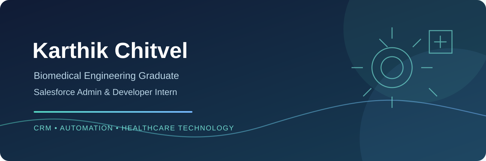

# Hi, I'm Karthik Chitvel 👋

### Biomedical Engineering Graduate | Salesforce Admin & Developer Intern

I’m a Biomedical Engineering graduate building practical skills in **Salesforce administration, CRM automation, data management, and healthcare technology**. I enjoy translating real-world requirements into organized data models and automated workflows.

---

## About me

- 🎓 B.Tech in Biomedical Engineering, Vel Tech, Chennai (2022–2026)
- 💼 Salesforce Admin and Developer Intern at **Vamritech Pvt. Ltd.**
- ⚙️ Interested in Salesforce configuration, Flow automation, CRM data quality, and healthcare applications
- 🌱 Currently learning **Apex, Apex Triggers, SOQL, and SOSL**
- 🧩 Bringing together a biomedical engineering background and practical CRM technology skills

## Technical skills

| Area | Skills |
|---|---|
| Salesforce Administration | Custom Objects and Fields, Relationships, Record Types, Page Layouts, Lightning App Builder, Validation Rules |
| Automation | Screen Flows, Record-Triggered Flows, Approval Processes |
| Security | OWD, Role Hierarchy, Permission Sets, Sharing Rules |
| Data Management | Data Import Wizard, Data Loader, Data Export, Duplicate Rules |
| Programming & Tools | SQL, Python (Basics), Microsoft Office Suite |
| Currently learning | Apex, Apex Triggers, SOQL, SOSL |

## Experience

**Salesforce Admin and Developer Intern — Vamritech Pvt. Ltd.**  
*2026 – Present*

- Configure Salesforce objects, fields, relationships, record types, and page layouts.
- Work with validation rules and access controls to support data quality and appropriate user access.
- Build workflow automation using Screen Flows and Record-Triggered Flows.
- Create reports and dashboards for data visibility.
- Develop foundational knowledge of Apex, SOQL, and SOSL.

## Featured projects

### 1. Patient Book — Salesforce Practice Application
A Salesforce application concept for organizing patient records and related information.

- Created custom fields and relational object data models.
- Used a Screen Flow for patient detail updates.
- Used a Record-Triggered Flow to automate follow-up task creation.
- Applied validation rules and permission structures.

[View project documentation](projects/patient-book-salesforce/README.md)

### 2. Detection of Gallbladder Lymphoma — Academic Capstone
An academic classification framework combining **Convolutional Neural Networks (CNN)** for feature extraction with **Relevance Vector Machines (RVM)** for classification.

- Preprocessed clinical image files.
- Explored a CNN + RVM classification workflow.
- Evaluated performance using sensitivity, specificity, and accuracy.

[View project documentation](projects/gallbladder-lymphoma-cnn-rvm/README.md)

### 3. Salesforce Apex & SOQL Practice
A learning repository with an Apex Contact follow-up task service, illustrative unit tests, and SOQL query examples.

[Explore Apex and SOQL practice files](salesforce-practice/README.md)

> Project descriptions reflect the work documented in my resume. The Apex/SOQL folder is a separate learning exercise. I will add original project source code, screenshots, datasets, and numerical results only when they are available and appropriate to share.

## Education

**B.Tech — Biomedical Engineering**  
Vel Tech Rangarajan Dr. Sagunthala R&D Institute, Chennai | 2022–2026  
CGPA: 7.38

## Certifications & training

- Critical Care Equipment Operation & Maintenance
- Application of Biomechanics in Ergonomics

## What I'm working towards

- Strengthening Salesforce administration and platform development skills.
- Practising Apex, SOQL, and SOSL through small, documented exercises.
- Building projects that demonstrate CRM configuration, automation, and data handling.

## Let's connect

- **LinkedIn:** [karthikchitvel](https://www.linkedin.com/in/karthikchitvel/)
- **Email:** [chitvelkarthik@gmail.com](mailto:chitvelkarthik@gmail.com)
- **Portfolio:** [Open portfolio website](https://chitvelkarthik-sketch.github.io/chitvelkarthik-sketch/)

---

*Thanks for visiting my profile!*
