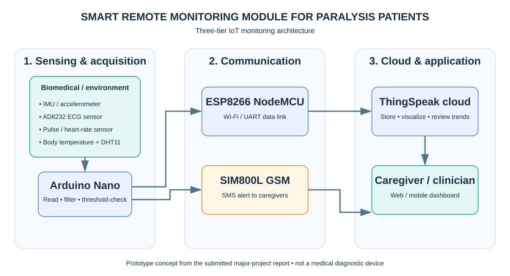

# Smart Remote Monitoring Module for Paralysis Detection Using IoT Applications

**Academic major project | B.Tech Biomedical Engineering | May 2026**

A multi-sensor IoT prototype designed to support remote monitoring of paralysis patients in home-care settings. The system collects movement and physiological readings, applies threshold-based checks on a microcontroller, sends data to a cloud dashboard, and uses GSM SMS notifications for caregiver alerts.

## Project overview

The project explores how affordable embedded hardware and IoT communication can help caregivers remotely observe selected patient parameters. Its architecture is organized into three tiers:

1. **Sensing and acquisition:** motion / IMU sensing, ECG, pulse / heart-rate sensing, body temperature, and environmental temperature and humidity.
2. **Communication:** Arduino Nano processes readings and applies threshold checks; ESP8266 provides Wi-Fi connectivity; SIM800L provides SMS alert delivery.
3. **Cloud and application:** ThingSpeak stores and visualizes readings for remote review through web or mobile dashboards.

**[View the actual hardware setup photograph](hardware-photo.html)** — extracted from Figure 3.14 (PDF page 35) of the submitted project report.

## Hardware described in the report

| Component | Role in the prototype |
|---|---|
| Arduino Nano (ATmega328P) | Central controller; sensor acquisition, basic filtering and threshold checks |
| IMU / accelerometer | Body movement, posture and immobility monitoring |
| AD8232 ECG module | Captures cardiac electrical activity |
| Pulse sensor / pulse-oximeter module | Heart-rate monitoring |
| DS18B20 temperature sensor | Body-temperature measurement |
| DHT11 | Ambient temperature and humidity |
| ESP8266 NodeMCU | Wi-Fi communication to ThingSpeak |
| SIM800L GSM module | SMS notifications to caregiver contacts |
| LM2596 DC-DC converters | Regulated power rails |
| 7.4 V Li-ion battery pack | Portable power source |

**Implementation note:** The report uses more than one model designation for the motion and pulse-sensing hardware in different sections (for example, MPU-6050 and ADXL335; pulse sensor and pulse oximeter). This README therefore describes those modules by function rather than claiming one final model. Confirm the exact bill of materials against the final assembled hardware before a technical interview or replication.

## Software and communication

- Arduino IDE 2.3 for Arduino Nano firmware (Embedded C / C++).
- ThingSpeak for cloud data storage and visualization.
- ESP8266 Wi-Fi communication; the report describes HTTP API updates in the cloud-integration section and MQTT in the performance discussion.
- SIM800L AT-command interface for SMS alerts.
- IFTTT / webhook-based alert automation and ThingView Free for mobile dashboard viewing.
- Proteus Design Suite 8.15 and MATLAB R2023b are listed as supporting design / analysis tools.

## Threshold examples documented in the report

| Parameter | Example threshold in report |
|---|---|
| Body temperature | ≥ 38 °C |
| Low heart rate | ≤ 40 BPM |
| High heart rate | ≥ 160 BPM |
| ECG lead-off | LO+ or LO− is HIGH |
| Pulse timeout | No beat for more than 2500 ms |
| Motion / fall axes | Axis sample deviation greater than 3 ADC counts |

These are the prototype's configured alert conditions as documented in the report. They are **not universal clinical thresholds and must not be used to diagnose paralysis or make treatment decisions**.

## Reported prototype observations

The Results and Discussion chapter reports the following measurements:

- Average cloud data transmission latency: **1.34 seconds**.
- Packet loss under the report's simulated weak Wi-Fi conditions: **2.1%**.
- Under stronger Wi-Fi conditions, the report states packet loss was effectively zero during a **48-hour** continuous test.
- Average GSM SMS delivery time: **6.8 seconds**.
- The report describes more than **200 simulated alert events** and retry attempts when an alert was not acknowledged.

These are values reported in the submitted academic report; they have not been independently reproduced or audited in this repository.

## Prototype cost

The report's component budget table gives a total prototype estimate of approximately **₹2,540**. This is the report's historical estimate, not a current market quotation.

## Team context

This was a team major project completed with **Nikkudala Harshitha** and **Devanaboina Vyshnavi**, under the guidance of **Dr. R. Indumathi**, Department of Biomedical Engineering. The submitted report identifies Chitvel Karthik as a team member.

For interviews, describe your personal work accurately: explain the modules you personally designed, wired, programmed, tested, documented, or presented rather than claiming every team task as an individual contribution.

## Limitations and future scope

The submitted report identifies future directions including:
- AI / ML-based anomaly detection and predictive analytics.
- A dedicated Android / iOS caregiver application.
- Improved cloud analytics and historical reporting.
- Battery optimization and energy harvesting.
- Smaller wearable hardware and broader hospital / telemedicine integration.

This project is a **student prototype for remote monitoring**, not a clinically validated medical device and not a standalone paralysis diagnostic system. Sensor accuracy, thresholds, network availability, power stability, and clinical suitability require further validation before any real-world medical use.

## Source

Based on the team's 70-page major project report, *Smart Remote Monitoring Module for Paralysis Detection Using IoT Applications* (May 2026). The original report is not reproduced in this public repository; this page summarizes its design and reported results.
